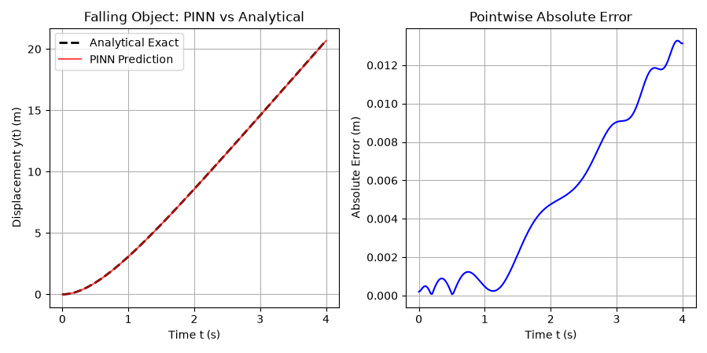

# PINN: Air Resistance Simulation

## Introduction

This folder demonstrates how to train a Physics-Informed Neural Network (PINN) to model the differential equation of a falling object subject to linear air resistance (drag):

$$\frac{d^2y}{dt^2} + \frac{k}{m}\frac{dy}{dt} = g$$

Where:
* $y(t)$ is the vertical position (displacement) over time $t$.
* $\frac{dy}{dt}$ is the velocity.
* $\frac{d^2y}{dt^2}$ is the acceleration.
* $k$ is the drag coefficient, $m$ is the mass, and $g$ is the acceleration due to gravity.

## File Structure

| File | Description |
| :--- | :--- |
| `model.py` | Neural network architecture, loss formulation, and training loop |
| `evaluate.py` | Model evaluation and inference script |
| `visualdemo.py` | Visualization scripts to plot displacement, velocity, and acceleration profiles |

---

## Discussion & Visual Results

This demonstrates that the PINN successfully learned the underlying second-order differential equation and satisfied the governing physics without overfitting.

---

## Predicted Results

| Time ($t$) | Position ($y$) | Velocity ($v = \dot{y}$) | Acceleration ($a = \ddot{y}$) |
| :---: | :---: | :---: | :---: |
| **0.50 s** | 0.955 m | 3.364 m/s | 4.394 m/s² |
| **1.25 s** | 4.346 m | 5.292 m/s | 1.296 m/s² |
| **2.00 s** | 8.573 m | 5.873 m/s | 0.405 m/s² |
| **3.75 s** | 19.138 m | 6.103 m/s | 0.065 m/s² |